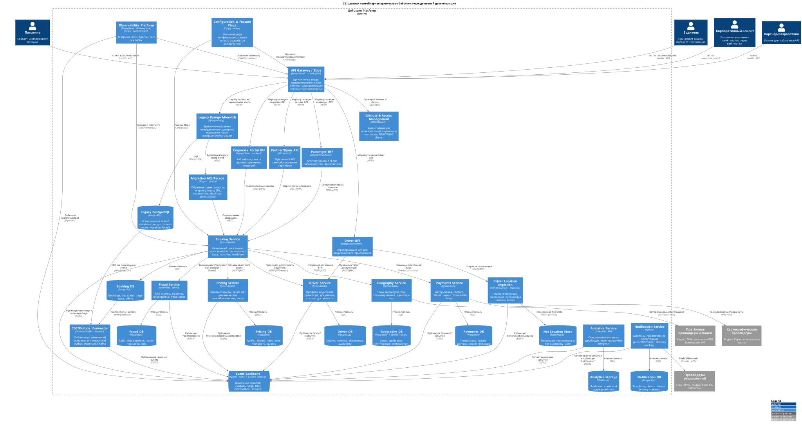

# Task 1. Доменная декомпозиция монолита «GoFuture»

## ADR-001. Переход от монолита к доменным микросервисам

### Статус

Предложено

### Контекст

«GoFuture» развивается как Django-монолит с единой PostgreSQL-базой. Текущая архитектура ограничивает масштабирование до 500 тысяч конкурентных поездок, увеличивает время выхода функций до полугода и приводит к каскадным отказам при пиковых нагрузках. Компания выходит на рынки Юго-Восточной Азии и Южной Америки, где дополнительно появляются требования локализации, регуляторного соответствия и низкой сетевой задержки.

Организационно компания уже разделена на продуктовые команды Booking, Driver, Pricing, Payments, Notification, Geography, Analytics и Fraud. Поэтому целевая архитектура должна повторять доменные границы команд: это уменьшает когнитивную нагрузку, сокращает кросс-командные блокировки и делает владение данными прозрачным.

### Требования

1. Сохранить работоспособность монолита на весь период миграции.
2. Разделить систему на доменные сервисы с независимыми базами данных.
3. Обеспечить независимое масштабирование высоконагруженных доменов Driver, Booking и Pricing.
4. Сохранить совместимость мобильных приложений и корпоративного портала.
5. Обеспечить миграцию больших объёмов данных без длительного простоя.
6. Подготовить основу для event-driven архитектуры, глобального развёртывания и мультитенантности.

### Решение

Переход выполняется по шаблону **Strangler Fig** через четыре повторяющиеся волны:

1. выделение платформенного фундамента;
2. выделение слабо связанных сервисов;
3. выделение нагруженных доменов;
4. расщепление ядра Booking и окончательный вывод монолита из эксплуатации.

Подробные артефакты:

- [Нефункциональные требования](./nfr.md)
- [Карта доменных сервисов](./service-map.md)
- [Очерёдность выделения сервисов и годовой план](./extraction-roadmap.md)
- [Механизмы обратной совместимости](./backward-compatibility.md)
- [План миграции данных](./data-migration-plan.md)
- [Диаграмма C2 To-Be](./c2-to-be.puml) / [rendered SVG](./c2-to-be.svg)

### Ключевые принципы целевой архитектуры

- **Database per service.** Сервис владеет своей схемой и не допускает прямых SQL-обращений из других доменов.
- **API для команд и событий для фактов.** Синхронные REST/gRPC-запросы используются для управляющих операций, а доменные события публикуются в Kafka.
- **Сильная согласованность локально, eventual consistency между доменами.** Например, платёжный журнал согласован строго, а аналитика и уведомления — в конечном итоге.
- **Платформенные возможности вынесены из продуктовых команд.** Observability, API Gateway, IAM, CI/CD и service mesh развивает платформенная команда.
- **Региональная независимость.** Каждый сервис с первого дня проектируется с учётом развёртывания в нескольких регионах.

### Альтернативы

| Альтернатива | Почему не выбрана |
|---|---|
| Big bang-переписывание монолита | Высокий риск остановки бизнеса, длительный период без ценности, почти неизбежное расхождение функциональности старой и новой систем |
| Модульный монолит как конечная цель | Уменьшает связанность кода, но не решает независимое масштабирование, изоляцию отказов, независимые релизы и региональное распределение |
| Декомпозиция по техническим слоям | Контроллеры, DAO и интеграции остаются связанными через доменные транзакции; команды продолжают блокировать друг друга |
| Общая распределённая база данных | Сохраняет скрытую связанность, усложняет миграции, делает невозможным независимое масштабирование и региональное владение данными |

### Компромиссы и риски

| Компромисс/риск | Митигация |
|---|---|
| Временное усложнение эксплуатации из-за параллельной работы монолита и сервисов | Ввести единый observability-стек, service ownership и чёткие критерии вывода legacy-кода |
| Распределённые транзакции вместо локальных транзакций Django | Использовать Saga, transactional outbox, idempotent consumers и explicit state machine |
| Возможное увеличение latency из-за сетевых вызовов | Кеширование, асинхронные события, локальные read models и запрет глубоких синхронных цепочек |
| Риск «распределённого монолита» | Проверять границы через владение данными, независимый деплой, consumer-driven contracts и architecture fitness functions |
| Нехватка платформенной зрелости | Первый этап миграции начинается с CI/CD, observability, API Gateway, IAM и event backbone |

### Критерии успеха декомпозиции

- критичные сервисы достигают availability 99,95–99,99%;
- MTTR снижается до менее 1 часа на промежуточном этапе и до 15 минут после внедрения автоматического failover;
- система обрабатывает более 500 тысяч конкурентных поездок;
- независимый релиз доменного сервиса занимает менее одного дня, а выход новой функции — до двух недель;
- монолит не содержит бизнес-логики доменов после завершения миграции;
- миграция данных каждого домена выполняется с простоем не более нескольких минут на этап финального переключения.
