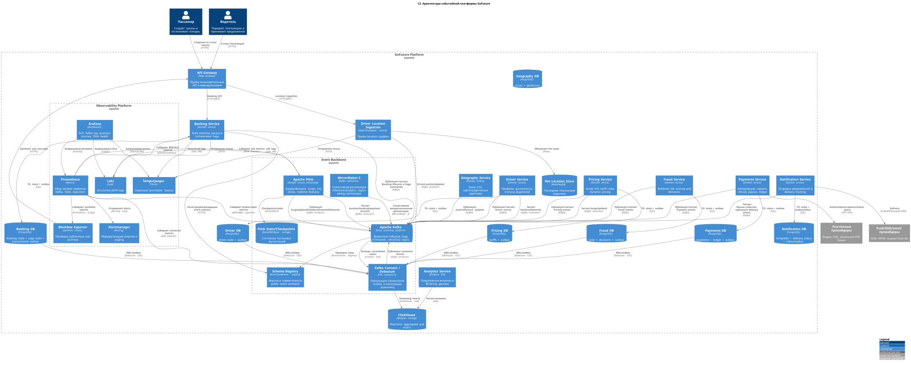

# Task 2. Event-driven архитектура «GoFuture»

## ADR-002. Построение событийной платформы на Kafka

### Статус

Предложено

### Контекст

Для 500 тысяч конкурентных поездок система должна обрабатывать десятки тысяч бизнес-событий и сотни тысяч геопозиционных событий в секунду. Динамическое ценообразование и оптимизация распределения водителей требуют вычислений близких к реальному времени. Существующий RabbitMQ/Celery подходит для фоновых задач монолита, но не является единым журналом доменных событий, не обеспечивает удобное масштабирование потоковой обработки и не даёт replay-возможностей для построения read models и аналитики.

### Требования

1. Ввести модель доменных событий, включая BookingCreated, DriverLocationUpdated и связанные события жизненного цикла поездки.
2. Определить схему топиков Kafka и партиционирование с учётом регионов.
3. Выбрать технологии realtime consumers.
4. Спроектировать Saga для распределённого сценария заказа.
5. Обеспечить надёжную доставку без потерь и дублей бизнес-эффектов.
6. Определить подход к мониторингу, метрики и инструменты.
7. Отразить событийную платформу и мониторинг на C2-диаграмме.

### Решение

Основой событийной платформы становится **Apache Kafka** с Schema Registry, Kafka Connect и потоковой обработкой в **Apache Flink**. Доменные сервисы публикуют события через transactional outbox. Критичный сценарий заказа реализуется как **orchestrated Saga** внутри Booking Service. Для простых реакций используются идемпотентные consumer-приложения доменов, а сложные stateful вычисления — Flink jobs.

Подробные артефакты:

- [Модель доменных событий](./event-model.md)
- [Схема топиков Kafka и партиционирование](./kafka-topics.md)
- [Saga жизненного цикла заказа](./saga.md)
- [Механизмы надёжной доставки](./reliability.md)
- [Подход к мониторингу, метрики и инструменты](./monitoring.md)
- [C2-диаграмма событийной платформы](./c2-event-platform.puml) / [rendered SVG](./c2-event-platform.svg)

### Почему Kafka, а не только RabbitMQ

| Критерий | RabbitMQ/Celery | Kafka |
|---|---|---|
| Высокочастотный location stream | Ограниченно: очередь ориентирована на команды/задачи | Подходит: append-only log, масштабирование партициями |
| Replay событий | Слабо выражен | Нативно поддержан retention/replay |
| Потоковая аналитика | Требует внешних интеграций | Экосистема Flink/Kafka Streams/Connect |
| Event sourcing/read models | Не основной сценарий | Естественная модель журнала |
| Региональное партиционирование | Сложнее стандартизировать | Поддерживается ключами и топиками |

RabbitMQ может временно остаться для legacy Celery jobs, но не используется для новых доменных событий. Новые интеграции строятся только на Kafka.

### Почему Flink

- сложные stateful вычисления по окнам: supply/demand, hot zones, скорость изменения спроса;
- exactly-once state processing и сохранение checkpoints;
- интеграция с Kafka и ClickHouse/lakehouse;
- масштабирование независимо от продуктовых сервисов.

Kafka Streams не выбран как основной стандарт, потому что backend GoFuture преимущественно Python, а размещение stream processing в отдельной платформе Flink лучше отделяет операционные сервисы от аналитических/вычислительных нагрузок.

### Компромиссы

| Компромисс | Митигация |
|---|---|
| Kafka усложняет эксплуатацию по сравнению с RabbitMQ | Managed/standardized platform, Infrastructure as Code, отдельная platform ownership, automation runbooks |
| Eventual consistency требует изменения UX и support tooling | Явные статусы обработки, read models, end-to-end tracing, SLA на обновление проекций |
| Схемы событий становятся public contract | Schema Registry, compatibility checks, ownership и change management |
| Некорректное партиционирование может привести к hotspot | Ключи по booking/driver/zone, мониторинг skew, контроль количества партиций |
| Exactly-once end-to-end недостижим в чистом виде из-за внешних API | Применяется effectively-once: outbox + idempotency + deduplication + compensation |

### Критерии успеха

- платформа выдерживает до 250 тысяч location events/с глобально с запасом на рост;
- critical events доходят до ключевых потребителей с p95 ≤ 2 секунд;
- потери сообщений внутри платформы равны нулю при корректной работе кластера;
- потребители безопасно переживают retry/replay без дублирования бизнес-эффектов;
- команды могут добавлять новые события без изменения центральной кодовой базы;
- мониторинг показывает lag, ошибки схем, DLQ, end-to-end latency и бизнес-KPI в одном observability-стеке.
