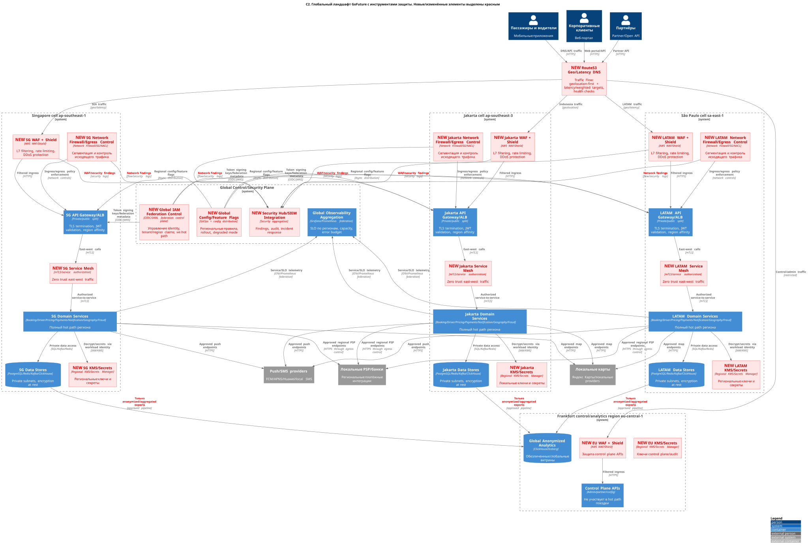
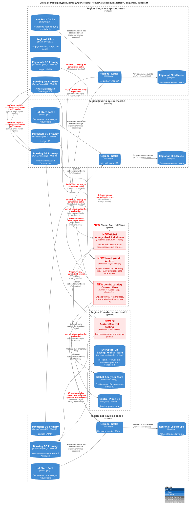
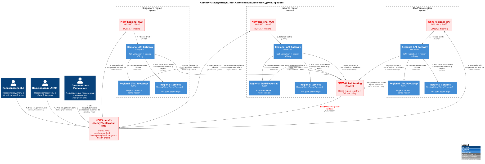
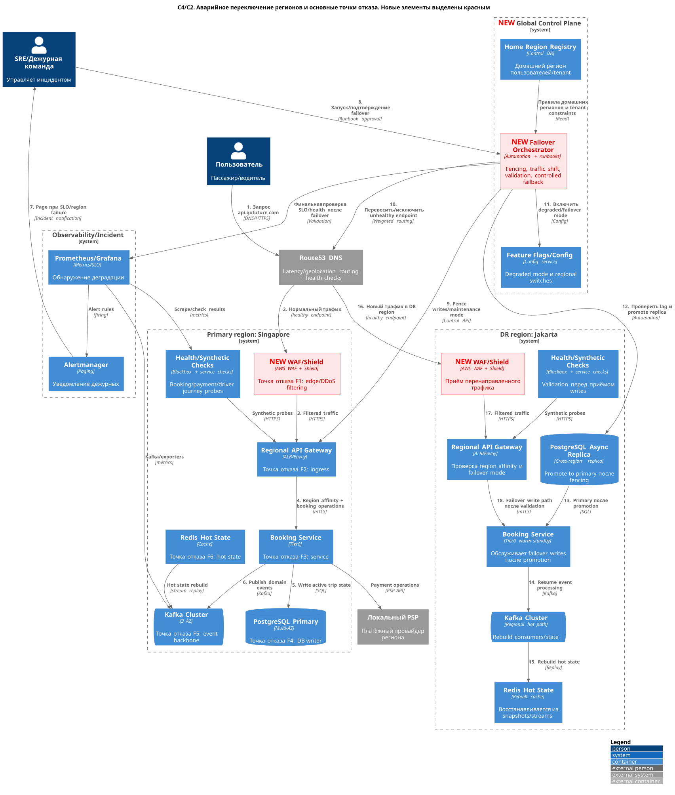

# Task 3. Глобальное развёртывание, отказоустойчивость и защита

## ADR-003. Регионально-ячеистая архитектура для 99,99% доступности

### Статус

Предложено

### Контекст

«GoFuture» выходит в Юго-Восточную Азию и Южную Америку. Пользователи чувствительны к задержке: создание заказа, передача геопозиции и обновление статуса поездки не должны зависеть от межконтинентальных обращений. Одновременно требуется соблюдать локальные регуляторные требования и обеспечивать доступность критичных сервисов до 99,99%.

Один центральный регион не подходит: межконтинентальная latency ухудшает клиентский опыт, а отказ региона приводит к глобальному простою. Полностью active-active глобальная запись одной и той же сущности из разных регионов также не подходит из-за конфликтов, сложности согласованности и стоимости.

### Требования

1. Развернуть платформу более чем в трёх географических регионах.
2. Маршрутизировать пользователя к ближайшему корректному региону.
3. Обеспечить репликацию данных и аварийное переключение.
4. Локализовать данные там, где это требуется регуляторно.
5. Встроить средства защиты периметра и внутренней сети.
6. Выделить изменения в ландшафте красным цветом на диаграммах.

### Решение

Выбрана **regional cell architecture**:

- каждый production-регион является независимой ячейкой с полным набором критичных сервисов;
- активная поездка и связанные с ней операции обрабатываются в домашнем регионе;
- синхронная репликация выполняется только внутри региона между зонами доступности;
- между регионами — асинхронная репликация справочников, DR-данных и обезличенной аналитики;
- геомаршрутизация сочетает DNS latency/geolocation routing и region affinity из пользовательского контекста;
- failover управляется control plane и health checks с защитой от split-brain.

Подробные артефакты:

- [Обоснование выбора регионов](./region-selection.md)
- [Схема репликации данных](./replication.md) и [diagram](./replication.puml) / [SVG](./replication.svg)
- [Геомаршрутизация](./georouting.md) и [diagram](./georouting.puml) / [SVG](./georouting.svg)
- [Failover и таблица сценариев отказа](./failover.md) и [C4-диаграмма](./failover-c4.puml) / [SVG](./failover-c4.svg)
- [Стратегия комплаенса](./compliance.md)
- [Механизмы защиты и обоснование C2](./security.md)
- [C2 глобального ландшафта и защиты](./c2-global-security.puml) / [SVG](./c2-global-security.svg)

### Альтернативы

| Альтернатива | Почему не выбрана |
|---|---|
| Один центральный регион + CDN | CDN ускоряет статический контент, но не транзакционные API и location ingestion; региональный отказ остаётся глобальным |
| Глобальная active-active БД для всех сущностей | Конфликты записи, сложная консистентность, высокая стоимость и риск split-brain |
| Полностью независимые страновые системы | Дублирование разработки, слабое переиспользование платформы, сложный запуск новых функций |
| Только active-passive DR без региональных ячеек | Не решает latency для пользователей и локальное соответствие требованиям |

### Компромиссы

| Компромисс | Митигация |
|---|---|
| Региональные ячейки увеличивают стоимость инфраструктуры | Autoscaling, shared control plane, минимальный размер ячейки для новых рынков, FinOps unit economics |
| Асинхронная репликация даёт RPO больше нуля для части данных | Классификация данных: платежи и активные поездки получают минимальный RPO, справочники — более высокий допустимый RPO |
| Failover сложно тестировать | Регулярные game days, automated failover drills, runbooks, chaos engineering |
| Локализация данных ограничивает глобальную аналитику | Использовать обезличивание, федеративные агрегаты и разрешённые cross-border data flows |
| Мультiregion усложняет deployment | GitOps, единый платформенный шаблон ячейки, progressive rollout по регионам |

### Критерии успеха

- p95 latency пользовательских API в целевых рынках не хуже 300–500 мс для ключевых операций;
- отказ одного региона не приводит к глобальной недоступности сервиса;
- для критичных сервисов availability достигает 99,99% при отсутствии глобальных зависимостей в hot path;
- RTO regional failover ≤ 15 минут, RPO для активных операций ≤ 1 минуты, для платёжного ledger — до нуля/минимального возможного за счёт synchronous multi-AZ и журналирования;
- выход в новую страну не требует переписывания платформы и занимает 2–4 недели.
