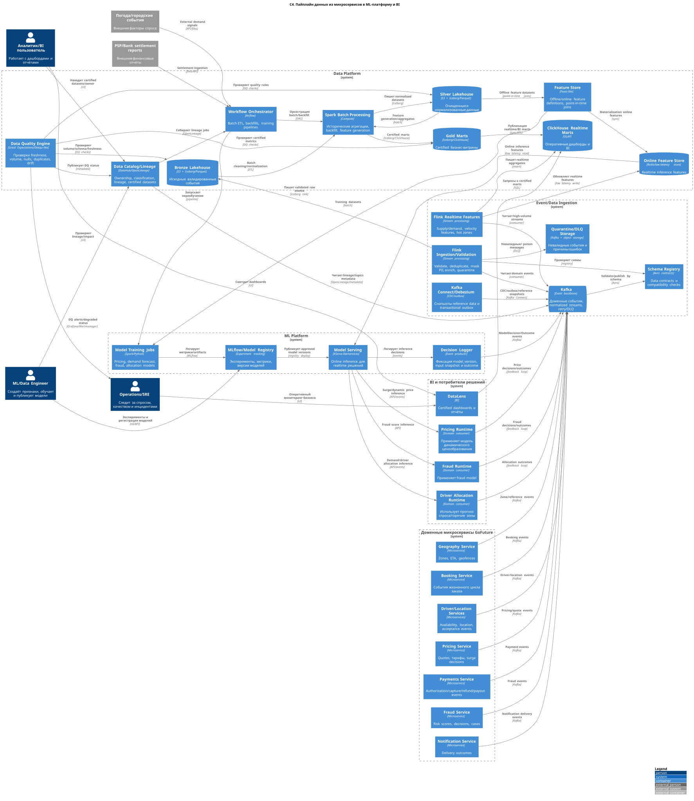

# Task 4. Data pipeline для ML-платформы и BI

## ADR-004. Единый поток данных от микросервисов к аналитике и ML

### Статус

Предложено

### Контекст

Для динамического ценообразования, прогнозирования спроса, оптимизации распределения водителей и обнаружения мошенничества нужны свежие и качественные данные из всех доменов. В монолите аналитика опиралась на прямые выгрузки из PostgreSQL и ETL-процессы. В микросервисной архитектуре такой подход невозможен: прямой доступ к чужим базам запрещён, а события становятся основным интеграционным механизмом.

### Требования

1. Собирать данные из всех микросервисов.
2. Обеспечить realtime и batch pipeline.
3. Интегрировать данные в ML-платформу и BI.
4. Поддерживать модели динамического ценообразования, прогнозирования спроса и антифрода.
5. Описать механизмы качества данных.
6. Не нарушать изоляцию доменов и требования к персональным данным.

### Решение

Выбирается **event-first data platform**:

- доменные события Kafka являются основным источником аналитических данных;
- transactional outbox гарантирует, что события отражают зафиксированные изменения;
- CDC используется только как дополнение для reference data и legacy миграции, но не как публичный контракт вместо domain events;
- Flink выполняет stream validation, deduplication, enrichment, masking и realtime aggregation;
- object storage с Iceberg/Parquet формирует lakehouse слои bronze/silver/gold;
- ClickHouse содержит realtime marts для операционной аналитики и BI;
- Feast-like Feature Store связывает offline training data и online inference features;
- MLflow управляет экспериментами, моделями и registry;
- model serving публикует прогнозы в Pricing/Fraud/Allocation через API или события;
- DataLens остаётся основным BI-инструментом поверх approved marts.

Подробные артефакты:

- [Описание механизмов качества данных](./data-quality.md)
- [C4-диаграмма pipeline данных](./c4-data-ml-bi.puml) / [rendered SVG](./c4-data-ml-bi.svg)

## Архитектурные слои

### 1. Источники

- Booking, Driver, Pricing, Payments, Notification, Geography, Fraud и Analytics events.
- CDC/outbox из PostgreSQL для согласованного снапшота и reference data.
- Внешние провайдеры: статусы PSP, отчёты settlement, качество карт, delivery receipts.
- Техническая телеметрия не смешивается с бизнес-данными, но может использоваться для capacity и anomaly detection.

### 2. Ingestion и stream processing

Kafka является единой шиной. Flink jobs выполняют:

- schema validation;
- normalization к canonical model;
- deduplication по event id;
- masking/tokenization PII;
- enrichment регионом, зоной, tenant;
- realtime aggregates supply/demand;
- формирование feature streams;
- маршрутизацию некорректных записей в quarantine.

### 3. Хранение

| Слой | Технология | Назначение |
|---|---|---|
| Bronze | Object storage + Iceberg/Parquet | Неизменные исходные события после технической валидации |
| Silver | Object storage + Iceberg/Parquet | Очищенные, дедуплицированные, нормализованные данные |
| Gold | Object storage/ClickHouse | Бизнес-витрины, агрегаты, approved BI datasets |
| Realtime marts | ClickHouse | Дашборды и оперативная аналитика с freshness seconds/minutes |
| Offline features | Lakehouse | Исторические признаки для обучения |
| Online features | Redis/Feature Store online serving | Признаки для realtime scoring |

### 4. ML-платформа

- Feature Store: единые определения признаков, point-in-time correctness, offline/online consistency.
- Training pipelines: Spark/Flink batch jobs и orchestration через Airflow.
- Experiment tracking/model registry: MLflow.
- Model serving: отдельные сервисы/KServe-like deployment с версией модели в telemetry.
- Decision logging: каждое решение модели публикует событие с `model_version`, input feature snapshot id и outcome.
- Feedback loop: фактические результаты поездок/платежей/фрода возвращаются в lakehouse для переобучения.

### 5. BI

- DataLens подключается только к approved gold/ClickHouse marts.
- Прямой доступ BI к operational PostgreSQL запрещён.
- Метрики имеют certified definitions: active trip, completed trip, cancellation, payment success, driver utilization.
- Разделение прав: региональные/tenant пользователи видят только разрешённые данные.

## ML use cases

| Use case | Входные потоки | Режим | Потребитель решения |
|---|---|---|---|
| Динамическое ценообразование | supply/demand, bookings, cancellations, weather/events, historical conversion | Realtime + batch retraining | Pricing Service |
| Прогнозирование спроса | исторические поездки, календарь, погода, события города | Batch + short-term realtime correction | Pricing, Driver Allocation, Ops |
| Обнаружение мошенничества | booking/payment events, device signals, velocity features, история блокировок | Realtime scoring + batch training | Fraud Service, Payments |
| Оптимизация водителей | location, availability, hot zones, ETA, acceptance rate | Realtime recommendation | Booking/Driver Matching |
| Churn/customer analytics | поездки, поддержка, уведомления, платежи | Batch | BI/Marketing/Ops |

## Обработка персональных данных

- PII отделяется на ingestion слое.
- Для аналитики используется псевдонимизация идентификаторов там, где прямой идентификатор не нужен.
- Точные координаты заменяются зонами/геохешами в long-term analytics, если нет законного основания хранить точный след.
- Cross-region переносится только обезличенный/агрегированный слой.
- Доступ к raw PII в данных ограничен отдельной ролью и audit logging.

## Альтернативы

| Альтернатива | Почему не выбрана |
|---|---|
| Прямые nightly dumps из всех PostgreSQL | Нарушает database-per-service, создаёт нагрузку на OLTP и даёт устаревшие данные |
| Только realtime streaming без lakehouse | Сложно переобучать модели, выполнять backfill и восстанавливать витрины |
| Только batch lakehouse | Не подходит для surge pricing, fraud realtime scoring и hot zone detection |
| Единый монолитный data warehouse вместо lakehouse+ClickHouse | Дорогой и менее гибкий для semi-structured event data и ML backfills |

## Компромиссы

- Event-first требует зрелой дисциплины схем и ownership событий.
- Двойное хранение lakehouse/ClickHouse увеличивает стоимость, но разделяет workloads ad hoc/ML и realtime BI.
- Feature Store требует governance, иначе команды будут создавать несовместимые признаки.
- Псевдонимизация снижает удобство расследований, поэтому нужен controlled re-identification process.

## Критерии успеха

- freshness critical realtime marts — секунды/минуты;
- point-in-time correct offline features для обучения;
- модель динамического ценообразования получает признаки с задержкой, совместимой с p95 pricing SLA;
- все certified BI metrics имеют владельца, lineage и data quality checks;
- повторный backfill pipeline воспроизводим и не требует ручных SQL-правок.
