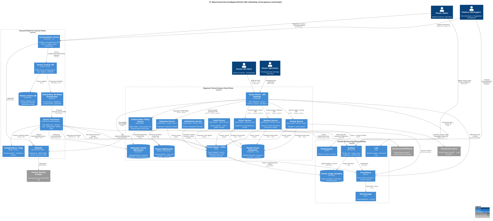
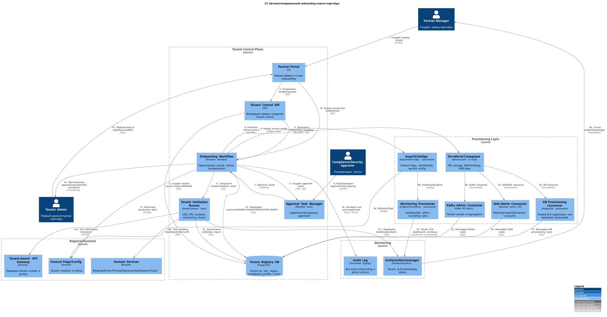

# Task 5. Мультитенантная платформа «GoFuture»

## ADR-005. Мультитенантность с гибридной изоляцией и автоматизированным onboarding

### Статус

Предложено

### Контекст

«GoFuture» должна быстро запускать решения для партнёров в новых регионах: локальные сервисы такси, банки, e-commerce и другие экосистемные участники. Партнёры требуют изоляции данных, кастомизации функций, SSO и прозрачного контроля доступа. Одновременно платформа должна сохранять экономическую эффективность и не создавать отдельную копию инфраструктуры для каждого небольшого партнёра.

### Требования

1. Разработать модель изоляции данных между партнёрами.
2. Внедрить IAM с ролевым доступом и SSO.
3. Автоматизировать onboarding новых партнёров.
4. Обеспечить мониторинг мультитенантного окружения.
5. Отразить решение на C2/C3 диаграммах.
6. Подготовить таблицу ролей и уровней доступа.

### Решение

Выбирается **гибридная мультитенантная модель**:

- **shared control plane** для управления tenant lifecycle;
- **pooled data plane** для стандартных партнёров с обязательным `tenant_id`, PostgreSQL Row-Level Security и отдельными IAM policies;
- **dedicated tenant cell/schema/database** для крупных, регулируемых или высоконагруженных партнёров;
- **tenant-aware application platform**, где tenant context проверяется на каждом запросе и включён в события, логи, метрики и authorization decisions.

В качестве IAM используется Keycloak-подобная OIDC/SAML платформа с federation во внешние корпоративные IdP. Автоматизация onboarding строится на Temporal workflow, Terraform/Crossplane и ArgoCD GitOps.

Подробные артефакты:

- [Модель изоляции данных](./tenant-isolation.md)
- [IAM, роли и матрица доступа](./iam-and-roles.md)
- [Автоматизированный onboarding партнёров](./onboarding.md)
- [Мониторинг мультитенантного окружения](./tenant-monitoring.md)
- [C2-диаграмма мультитенантной платформы](./c2-multitenant-platform.puml) / [SVG](./c2-multitenant-platform.svg)
- [C3-диаграмма процесса onboarding](./c3-onboarding-flow.puml) / [SVG](./c3-onboarding-flow.svg)

## Ключевые решения

### Tenant context

Каждый запрос содержит tenant context:

- `tenant_id`;
- `home_region`;
- `tenant_tier`;
- `compliance_profile`;
- user/service roles и scopes.

Tenant context формируется IAM/API Gateway, передаётся во внутренние вызовы и включён в доменные события. Сервисы не вычисляют tenant по user input самостоятельно.

### Изоляция

| Уровень | Для кого | Механизм |
|---|---|---|
| Shared row-level | Стандартные партнёры | `tenant_id` в каждой tenant-owned таблице, PostgreSQL RLS, composite keys, scoped indexes |
| Dedicated schema/database | Крупные партнёры или повышенные требования | Отдельная схема/БД в регионе, отдельные credentials и backup policy |
| Dedicated cell | Регулируемые/стратегические партнёры | Отдельный namespace/кластерные ресурсы/шифрование/региональная ячейка |
| Shared services, не tenant data | Платформенные функции | Observability, deployment, feature flag infrastructure без доступа к tenant payload |

### Кастомизация

- feature flags на tenant;
- конфигурация тарифов, зон, способов оплаты и уведомлений;
- локальные PSP/maps/push integrations через адаптеры;
- white-label settings для партнёрских приложений/порталов;
- запрет произвольных fork'ов кода для отдельного партнёра.

### Компромиссы

| Компромисс | Митигация |
|---|---|
| Row-level pooling создаёт риск noisy neighbour | Resource quotas, rate limits, per-tenant usage monitoring, авто scaling и аварийные throttles |
| Dedicated cells дороги | Применять только по бизнес/регуляторным критериям, automated provisioning для снижения операционной стоимости |
| Tenant_id в событиях повышает риск утечки при ошибках фильтрации | Kafka ACL, topic segregation для regulated tenants, schema validation и аудит consumer groups |
| SSO federation различается у партнёров | Поддержка OIDC/SAML, маппинг атрибутов и onboarding runbook |
| Слишком широкая кастомизация усложняет поддержку | Кастомизация только через configuration/feature flags; custom code запрещён |

## Критерии успеха

- стандартный партнёр подключается за дни, а не месяцы;
- новый tenant не требует ручного изменения схемы БД или кода доменных сервисов;
- доступ пользователей и сервисов проверяется централизованно и аудируется;
- партнёр не может получить данные другого tenant даже при ошибке application-level filtering;
- мониторинг показывает usage, latency, errors, cost и SLO в разрезе tenant без uncontrolled cardinality;
- regulated tenant может быть перенесён из pooled в dedicated режим без полной реализации заново.
